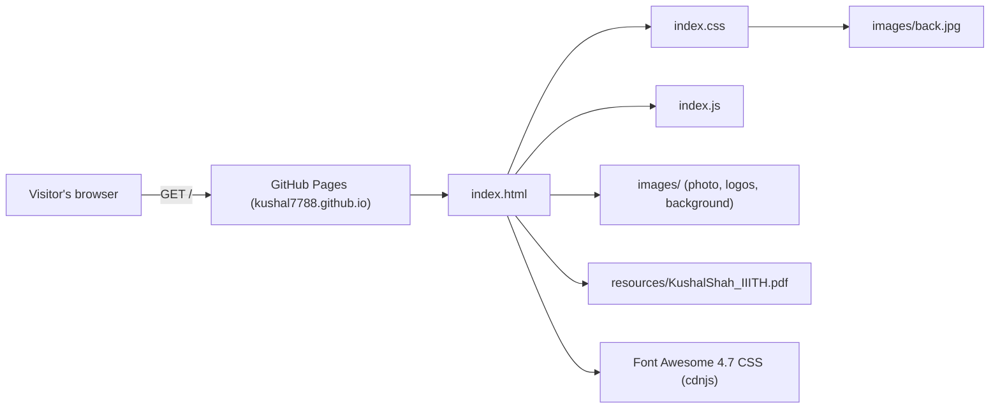

# Kushal Shah - Personal Website

A lightweight, dependency-free personal portfolio site (HTML, CSS and vanilla JavaScript) served by GitHub Pages.

**Live site:** https://kushal7788.github.io


## Overview

The site is a single HTML page that behaves like a small multi-tab application. A navigation bar switches between four content sections (Home, About, Education, Projects & Internships) without reloading the page, links out to a PDF CV, LinkedIn and GitHub, and shows a live clock in a fixed footer.

There is no framework, no build step and no package manager: the files in this repository are exactly the files the browser downloads.

## Key features

- **Single-page tab navigation** - four `<div>` sections are shown and hidden by JavaScript; only one is visible at a time.
- **Home card** - profile photo, headline and a "Know More" button that jumps to the About section.
- **About** - introduction, skills and extra-curricular highlights.
- **Education** - table of degrees with institution logos, dates and grades.
- **Projects & Internships** - an internships table plus project cards linking to the corresponding GitHub repositories.
- **CV download** - the navbar links directly to `resources/KushalShah_IIITH.pdf`.
- **Live clock** - the footer shows the current local date and time, refreshed roughly once a second.
- **Social links** - LinkedIn and GitHub icons from Font Awesome 4.7 (loaded from the cdnjs CDN).

## Architecture



`index.html` holds all content. `index.css` provides layout and styling (including the background image and the rule that hides the non-Home sections on load). `index.js` contains the tab-switching functions and the footer clock. A more detailed breakdown, including the deployment pipeline, is in [docs/ARCHITECTURE.md](docs/ARCHITECTURE.md).

## Tech stack

| Layer | Technology |
| --- | --- |
| Markup | HTML5 |
| Styling | Plain CSS (Flexbox, fixed footer, hover effects) |
| Behaviour | Vanilla JavaScript (DOM `style.display` toggling, `setInterval`) |
| Icons | Font Awesome 4.7.0 via cdnjs |
| CV | PDF (typeset separately with LaTeX `moderncv`; only the PDF is in this repo) |
| Hosting | GitHub Pages, classic "deploy from branch" build from `master` / root |

## Project structure

```text
.
├── index.html                 # The whole site: navbar, four sections, footer
├── index.css                  # All styles; hides #about, #education, #projects on load
├── index.js                   # displayHome/About/Education/Projects() and the footer clock
├── images/
│   ├── Pro-Pic med.jpg        # Profile photo on the Home card (file name contains a space)
│   ├── back.jpg               # Page background, referenced from index.css
│   ├── iiith.jpeg             # IIIT Hyderabad logo (Education table)
│   └── viit.png               # VIIT Pune logo (Education table)
├── resources/
│   └── KushalShah_IIITH.pdf   # CV linked from the navbar
├── docs/
│   └── ARCHITECTURE.md        # Page/asset structure and deployment flow
├── .gitignore
└── README.md
```

## Getting started

### Prerequisites

- Any modern web browser.
- Optional: Python 3 (or any static file server) to serve the folder over HTTP.

### Run locally

```bash
git clone https://github.com/Kushal7788/Kushal7788.github.io.git
cd Kushal7788.github.io
python3 -m http.server 8000
```

Then open http://localhost:8000.

Opening `index.html` directly from the file system also works, because every path is relative and there are no API calls. An internet connection is needed only for the Font Awesome icons.

There is nothing to install, configure or build.

## Usage

- Click **HOME**, **ABOUT**, **EDUCATION** or **PROJECTS & INTERNSHIPS** in the navbar to switch sections.
- Click **CV** to open the PDF resume.
- Use the LinkedIn and GitHub icons to visit those profiles.
- On each project card, **Know More** opens the project's GitHub repository.

### Updating content

All content lives in `index.html`; edit, preview locally, then push to `master`.

**Add a project** - copy an existing card inside `<div id="project-list">` → `<div class="cards">` and change the text and link:

```html
<div class="card">
    <h3>Project Title</h3>
    <p>One or two lines describing the project. <br>
        Technology stack used :- ... <br>
    </p>
    <a href="https://github.com/Kushal7788/<repo>" class="btn card_btn">Know More</a>
</div>
```

Cards wrap automatically (`#projects .cards` is a wrapping flex container), so no CSS changes are needed.

**Add an internship** - add a `<tr>` to `<table id="internship">`. For multiple bullet points under one role, set `rowspan` on the Company, Position and Date cells to the number of rows, as the existing entries do.

**Add an education entry** - add a `<tr>` to `<table id="edutable">`. Logos go in `images/` and are rendered at 200 x 200 px.

**Replace the CV** - overwrite `resources/KushalShah_IIITH.pdf`, or add a new file and update the `CV` link in the navbar.

**Add a new section** - this touches all three files:

1. Add `<div id="newsection">...</div>` to `index.html` and a navbar link with `onclick="displayNewsection()"`.
2. Add `#newsection { display: none; }` to `index.css`.
3. In `index.js`, add the element to `getTabElements()` and add a `displayNewsection()` function following the existing pattern.

## Deployment

The repository is a GitHub Pages **user site** (`<username>.github.io`), configured to build from the `master` branch, root folder:

1. Push a commit to `master`.
2. GitHub Pages runs its classic build automatically. Because there is no `.nojekyll` file, the build passes the repository through Jekyll; plain HTML/CSS/JS without front matter is copied as-is, and Markdown files (such as this README and `docs/ARCHITECTURE.md`) are also rendered as pages.
3. The result is published to https://kushal7788.github.io, usually within a minute or two.

Build status can be checked under the repository's **Settings → Pages**, or with:

```bash
gh api repos/Kushal7788/Kushal7788.github.io/pages/builds/latest
```

## How it works

**Section switching.** All four sections are present in the DOM from the start. `index.css` sets `display: none` on `#about`, `#education` and `#projects`, so only `#home` is visible on first paint. Each navbar link calls a function such as `displayEducation()`, which:

1. collects the four section elements through `getTabElements()`,
2. sets `style.display = "none"` on every one of them, and
3. sets `style.display = "block"` on the requested section.

Because the links use `href="#"`, the browser stays on the same document and the switch is instant. The trade-off is that the active section is not reflected in the URL, so it cannot be deep-linked or restored with the Back button.

**Footer clock.** `<body onload="starter()">` calls `getTime()`, which starts a `setInterval` that fires every 950 ms. Each tick takes `new Date().toString()`, keeps its first five space-separated tokens (weekday, month, day, year, time) and writes them into `#dateTime`. Until the first tick (just under a second after load) the footer clock is empty.

**Styling.** The background image is scaled to full width and repeated vertically. Content cards and tables use a semi-transparent `whitesmoke` background (`opacity` around 0.86-0.92) so the background shows through, with hover states that raise the shadow or opacity.

## Limitations and future work

- Content is hard-coded in HTML; there is no data file or template, so every update is a manual HTML edit.
- No `<meta name="viewport">` tag and fixed 200 px images, so the layout is not optimised for mobile screens.
- Section state is not in the URL (no `#about` style hash routing), so sections cannot be linked to directly.
- `index.js` assigns to undeclared variables (`elements`, `ele`, `dateEle`), creating implicit globals; it works in non-strict mode but would fail under `"use strict"`.
- The profile image file name contains a space (`Pro-Pic med.jpg`); it works because browsers encode the URL, but a hyphenated name would be more robust.
- Some page content (for example the M.Tech status and CGPA placeholder) reflects the time the site was last updated in 2021.
- Possible improvements: responsive layout, hash-based routing, accessible navigation (buttons instead of `href="#"` links, `aria` attributes), and moving content into a JSON file or Jekyll data file.

## Author

Kushal Shah - [github.com/Kushal7788](https://github.com/Kushal7788)
