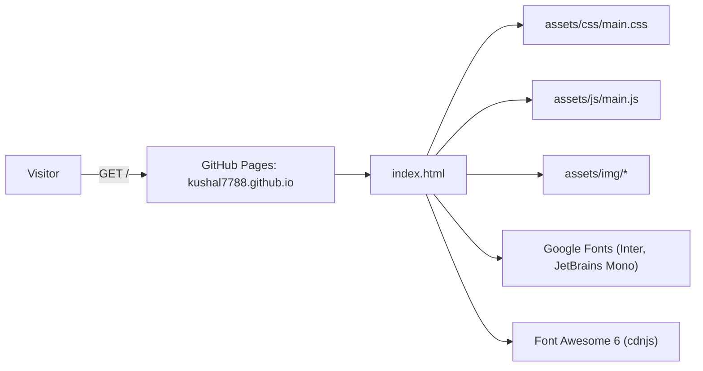

# kushal7788.github.io

My personal website: a single-page portfolio for my work as a **cryptography & research engineer** on zkTLS and zero-knowledge systems, my experience at Burnt Labs and Reclaim Protocol, and selected open-source projects.

**Live:** https://kushal7788.github.io · **Connect:** [LinkedIn](https://www.linkedin.com/in/kushal-s/) · [Telegram @KushalS7788](https://t.me/KushalS7788)


## Highlights

- **Dark-first design with a light theme.** It follows the visitor's OS preference, and a toggle remembers their choice.
- **Single page with anchor navigation:** About, Experience, Projects, Skills, Education and Contact, plus a sticky header that highlights the section in view.
- **Filterable project grid** (ZK & zkTLS, ML/NLP/IR, Systems), linking to each repository.
- **Responsive and accessible:** a mobile menu, a skip link, visible focus styles, alt text, keyboard-operable controls, and `prefers-reduced-motion` support.
- **Lightweight:** no framework and no build step. The files in this repo are exactly what the browser downloads, and the only external requests are Google Fonts and Font Awesome from cdnjs.
- **Search and sharing:**
  - `schema.org` Person, WebSite and ProfilePage JSON-LD, so search engines can tie the site to my GitHub, LinkedIn and Telegram.
  - Keyword-focused title and description, and `rel="me"` identity links.
  - `sitemap.xml` and `robots.txt`.
  - A 1200×630 social card (`assets/img/og-card.png`) for LinkedIn, Telegram and X previews.
  - A custom `404.html`.

## Structure

```text
.
├── index.html            # All content and sections, plus meta and JSON-LD
├── 404.html              # Not-found page
├── robots.txt            # Allows crawling; points to the sitemap
├── sitemap.xml           # Single-URL sitemap for search engines
├── assets/
│   ├── css/main.css      # Design tokens (dark and light), layout, components, responsive rules
│   ├── js/main.js        # Theme toggle, mobile menu, scroll reveal, nav highlight, project filters
│   └── img/              # Portrait, social card, institution logos, favicon
├── LICENSE
└── README.md
```



## Run locally

```bash
git clone https://github.com/Kushal7788/Kushal7788.github.io.git
cd Kushal7788.github.io
python3 -m http.server 8000      # then open http://localhost:8000
```

## Deployment

GitHub Pages serves the `master` branch from the repository root, and every push to `master` is live within a minute or two.

## Editing content

All content is in `index.html`:

- **Experience:** `<li class="t-item">` entries inside `#experience`.
- **Projects:** `<article class="p-card" data-tags="zk ml systems">` cards inside `#projects`. The `data-tags` values drive the filter chips.
- **Theme colours:** CSS custom properties at the top of `assets/css/main.css`.

## License

[MIT](LICENSE)
