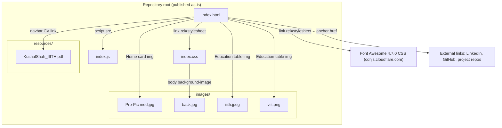
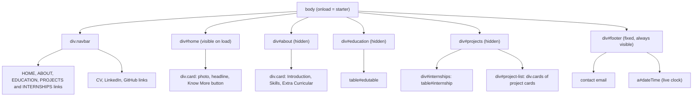
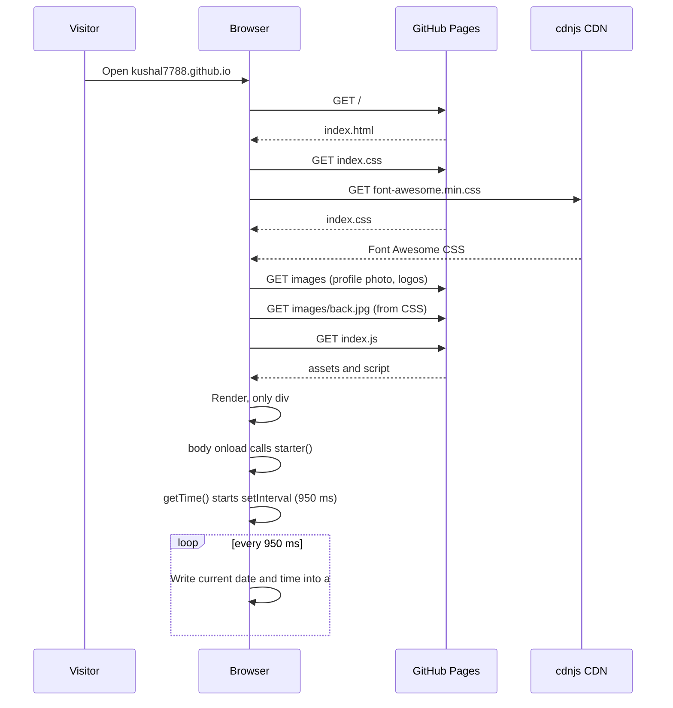
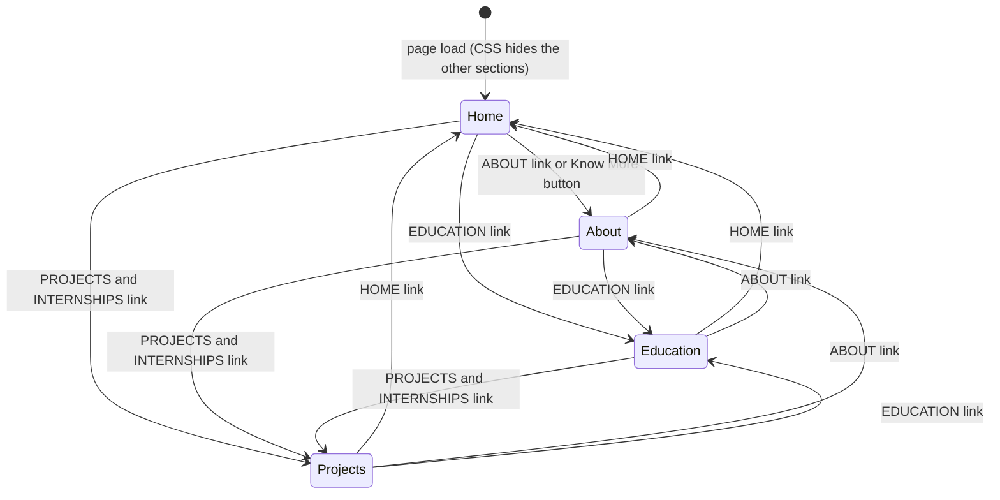
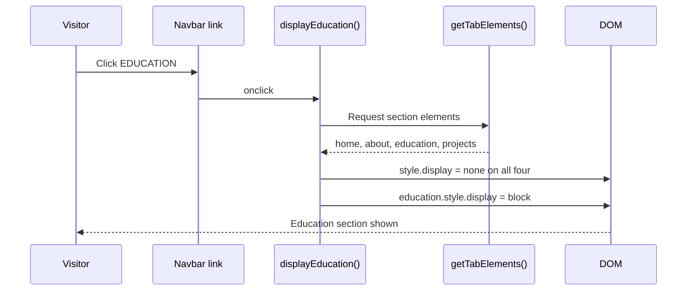
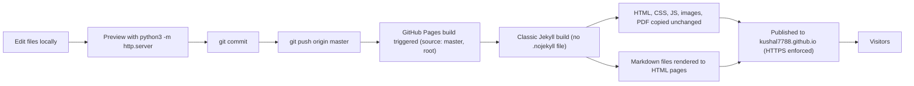

# Architecture

This document describes how the personal website at https://kushal7788.github.io is put together: which files make up the page, how the browser loads them, how the in-page navigation works, and how a commit becomes a live deployment.

The site is fully static. There is no server-side code, no build tooling in the repository and no runtime data source; everything is HTML, CSS, JavaScript and binary assets served by GitHub Pages.

## 1. Page and asset structure



*Figure 1 - Files that make up the site and how each one is referenced.*

`index.html` is the only page and the single entry point. It pulls in two stylesheets (the local `index.css` and Font Awesome from a CDN, used only for the LinkedIn and GitHub icons) and one script, `index.js`, which is included after the closing `</body>` tag. Three of the four images are referenced directly by `` tags in the HTML; the fourth, `back.jpg`, is referenced only from CSS as the page background. The CV PDF is not loaded with the page - it is fetched only when a visitor clicks the **CV** link. Every asset in the repository is referenced by the page; there are no orphaned files.

### Document layout



*Figure 2 - DOM structure of `index.html`.*

The page body is a flat list of six blocks. The navbar and footer are always visible; the four content sections in the middle are siblings, and the stylesheet hides three of them on load (`#about`, `#education` and `#projects` have `display: none`). The Projects section is itself split into an internships table and a wrapping flex container of project cards, which is where new projects are added (see the README's *Updating content* section).

## 2. Page load sequence



*Figure 3 - What happens when a visitor opens the site.*

All requests go to GitHub Pages except the Font Awesome stylesheet. Once the `load` event fires, `starter()` calls `getTime()`, which registers a repeating timer. The timer never stops for the lifetime of the page; each tick formats `new Date().toString()` down to its first five tokens (weekday, month, day, year and time) and writes the result into the footer.

## 3. Navigation model



*Figure 4 - The four content sections as states; exactly one is visible at a time.*

Each navbar link has `href="#"` and an `onclick` handler. Every handler (`displayHome`, `displayAbout`, `displayEducation`, `displayProjects`) follows the same two-step pattern: hide all sections returned by `getTabElements()`, then set the chosen one to `display: block`. Because the hide-all step runs first, any section can transition to any other, and clicking the link for the current section simply leaves it visible. The **Know More** button on the Home card calls `displayAbout()` directly.

The state is held only in the DOM's inline styles. It is not written to the URL hash or browser history, so reloading the page always returns to Home and the Back button does not move between sections.



*Figure 5 - One navigation click, end to end.*

## 4. Deployment flow



*Figure 6 - From local edit to live site.*

The repository's Pages settings use the classic "deploy from a branch" mode with `master` as the source branch and the repository root as the source folder. There is no GitHub Actions workflow in the repository; GitHub runs the build itself on every push to `master`.

Because there is no `.nojekyll` file, the build passes the repository through Jekyll. Files without YAML front matter that are not Markdown - which is every file the site actually uses - are copied to the output unchanged, so the published site is byte-for-byte the repository content. Markdown files are converted to HTML pages as a side effect: this README and `docs/ARCHITECTURE.md` are also reachable on the site, with Mermaid blocks shown as plain code (Mermaid rendering is a feature of github.com, not of GitHub Pages). Dotfiles such as `.gitignore` are excluded from the output by Jekyll's defaults.

Since Jekyll processes Liquid templates in Markdown, documentation added to this repository should avoid literal double-brace or brace-percent sequences, or wrap them in Liquid `raw` tags, to keep the build from failing.

The status of the most recent build can be checked with:

```bash
gh api repos/Kushal7788/Kushal7788.github.io/pages/builds/latest
```

A `status` of `built` means the deployment succeeded; `errored` includes a message describing the Jekyll failure.

## 5. Design notes and constraints

- **No build step by design.** The site can be served from any static host, or opened straight from disk, with identical behaviour.
- **Single external dependency.** Only the Font Awesome stylesheet is loaded from a third party. If the CDN is unreachable the page still works; the LinkedIn and GitHub icons simply do not render.
- **Content and presentation are coupled.** Content is written directly into `index.html`, with some line breaks controlled by `<br>` tags, so text changes may need manual reflowing.
- **Not responsive.** There is no viewport meta tag and several elements use fixed pixel sizes, so small screens show a scaled-down desktop layout.
